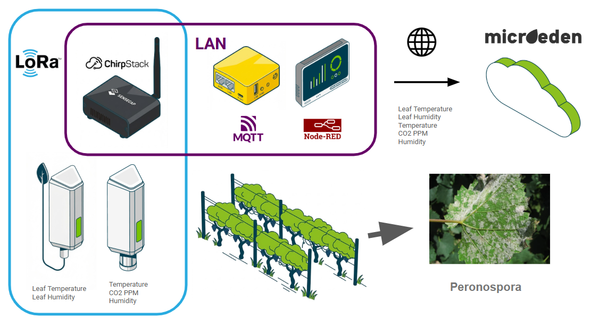
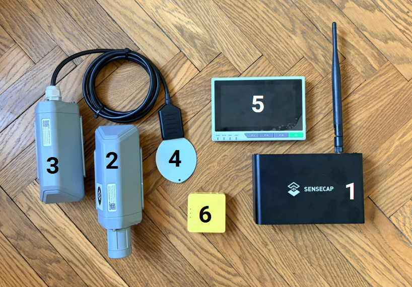
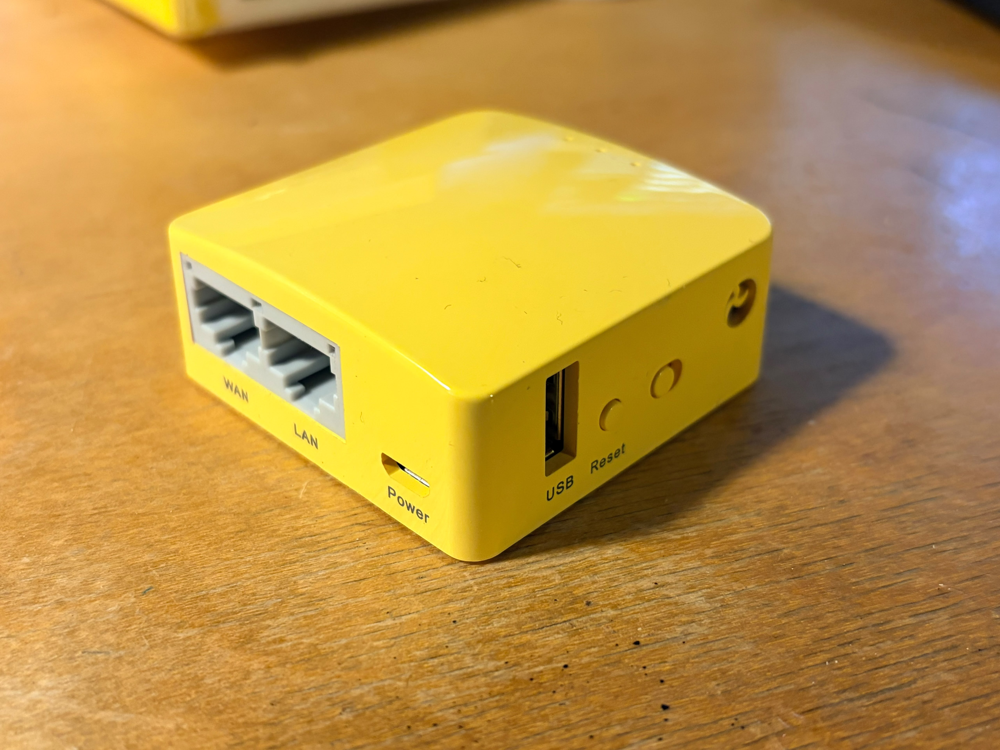
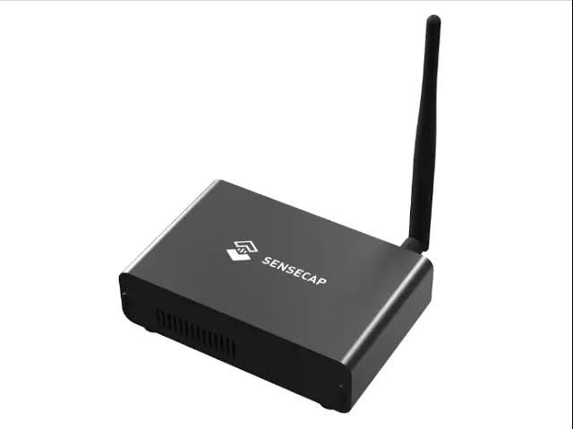
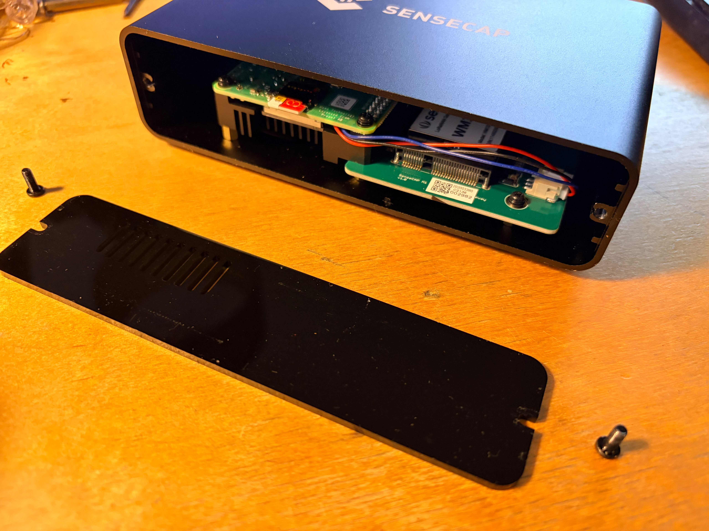
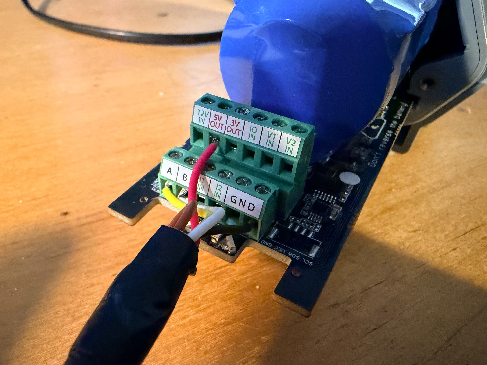
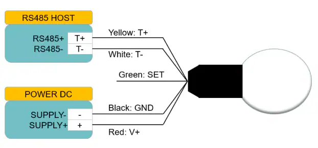
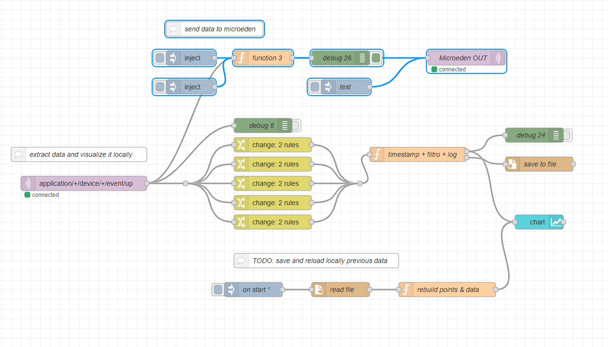
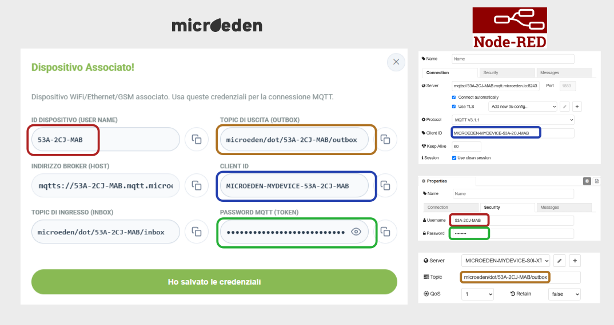
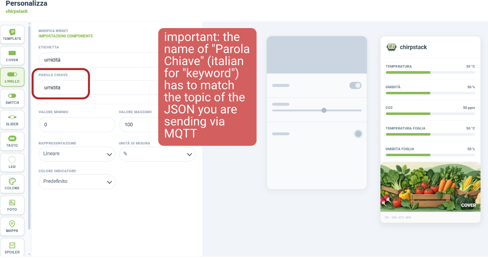

# LoRa in a Box — A Portable LoRaWAN Network for Smart Agriculture
A portable self-contained proof of concept featuring several Seeedstudio industrial products, Chipstack Application Server and microeden.io as Cloud

- **GL.iNet Mango** travel router as the network backbone
- **SenseCAP M1** gateway running **ChirpStack Gateway OS** (gateway + network server + MQTT broker in one box)
- **SenseCAP sensor nodes** joined via OTAA (e.g. a leaf wetness & temperature sensor for downy mildew monitoring)
- **reTerminal** running **Node-RED**: reads data from ChirpStack, shows it full screen, forwards it to **Microeden** over MQTT
- **Microeden** a very interesting adn cheap italian tool for visualising data and creating automation with a free tier

```
 [SenseCAP nodes] ~~LoRa~~> [SenseCAP M1 / ChirpStack OS] --eth--+
                                                                  |
                                       [GL.iNet Mango 192.168.7.1]--Wi-Fi (repeater)--> Internet --> Microeden
                                                                  |
                                       [reTerminal 192.168.7.185]--eth (Node-RED + kiosk dashboard)
```

> Values in `<ANGLE_BRACKETS>` are placeholders to fill in for your own setup.

---

## The main concept




---

## Part List



| # | Part | Role in the kit | Price |
|---|------|-----------------|------:|
| 1 | [SenseCAP M1](https://www.seeedstudio.com/SenseCAP-M1-LoRaWAN-Indoor-Gateway-EU868-p-5022.html) | LoRaWAN gateway running ChirpStack Gateway OS | 200 € |
| 2 | [SenseCAP S2103](https://www.seeedstudio.com/SenseCAP-S2103-LoRaWAN-CO2-Temperature-and-Humidity-Sensor-p-5356.html) | LoRaWAN CO₂, temperature & humidity sensor | 135 € |
| 3 | [SenseCAP S2100 Data Logger (DTU)](https://www.seeedstudio.com/SenseCAP-S2100-LoRaWAN-Data-Logger-p-5361.html) | LoRaWAN node that reads the leaf sensor over RS485 | 70 € |
| 4 | [Seeed Studio Leaf Wetness & Temperature Sensor (S-YM-01)](https://www.seeedstudio.com/leaf-wetness-sensor-p-a-4861.html) | Leaf wetness and leaf temperature, RS485 Modbus | 95 € |
| 5 | [reTerminal](https://www.seeedstudio.com/ReTerminal-with-CM4-p-4904.html) | Node-RED, full-screen dashboard, forwarding to Microeden | 300 € |
| 6 | [GL.iNet Mango (GL-MT300N-V2)](https://www.gl-inet.com/en-de/products/gl-mt300n-v2) | Travel router, private LAN + internet via Wi-Fi | 30 € |
| 7 | Cables & plugs | Ethernet, power, wiring | 20 € |
| 8 | Rugged case | Transport and field protection | 80 € |
|   | **Total** | | **930 €** |

---

## 1. Power Supply

When designing something to be broght or installed around - always start from the power supply!  In this case it's the cursed italian standard, aka Type L


---

## 2. GL.iNet Mango — Network Configuration

The Mango (GL-MT300N-V2) creates a private LAN for the gateway and the reTerminal, and takes its internet connection from any available 2.4 GHz Wi-Fi network.



Skip to 2.3 if it's a new one

### 2.1 Factory reset

- **Button reset:** with the router booted, hold **Reset** for ~10 s until the LEDs blink, then release.
- **Web reset:** firmware 4.x → *System → Reset Firmware*; firmware 3.x → *More Settings → Revert Firmware*.
- **U-Boot recovery** (bricked router): hold Reset while plugging in power, release after 5 LED blinks, set the PC to static `192.168.1.2/24`, open `http://192.168.1.1` and upload a firmware `.bin`.

### 2.2 Firmware upgrade (3.x → 4.x)

Our unit shipped with firmware **3.215**, where changing the LAN IP from the web UI did not persist. We upgraded to **4.3.25** (stable):

1. Download the firmware for **GL-MT300N-V2** from `dl.gl-inet.com` (Stable tab).
2. *UPGRADE → Local Upgrade*, drag & drop the `.bin`.
3. **Uncheck "Keep Settings"** (3.x settings are not compatible with 4.x).
4. Wait 3–4 minutes, then open `http://192.168.8.1` and set a new admin password.

> Tip: on firmware 3.x, SSH to the router fails on modern clients with `no matching host key type found`. Use:
> `ssh -o HostKeyAlgorithms=+ssh-rsa -o PubkeyAcceptedAlgorithms=+ssh-rsa root@192.168.8.1`

### 2.3 LAN IP

The default `192.168.8.0/24` subnet often collides with upstream networks, so we moved the LAN to **`192.168.7.1`**:

- *NETWORK → LAN → Router IP* → `192.168.7.1`, DHCP range `192.168.7.100–249`, **Apply**.
- Unplug/replug the Ethernet cable and reconnect at `http://192.168.7.1`.

### 2.4 Wi-Fi name (SSID)

*WIRELESS → 2.4 GHz Wi-Fi → Modify* → set SSID and password (WPA2-PSK) → **Apply**.

### 2.5 Internet via Repeater mode

*INTERNET → Repeater → Connect* → pick the upstream 2.4 GHz network, enter the password, keep **Remember this network** checked.

In Repeater mode the Mango NATs its own `192.168.7.x` LAN behind the upstream network, so device IPs stay the same wherever we go.
(The alternative, *NETWORK → Network Mode → Extender*, bridges devices onto the upstream LAN — not used here.)

### 2.6 Ethernet ports

The Mango has only **one LAN port**. To wire both the M1 and the reTerminal, either:

- convert the unused **WAN port to LAN** (possible because internet arrives via Wi-Fi), or
- add a small **Ethernet switch** on the LAN port.

### 2.7 IP reservation (static leases)

To keep the gateway and the reTerminal on fixed addresses across reboots, reserve their IPs on the Mango:

- *Clients* → on the device row click **•••** (Action) → **Reserve IP**, or
- *NETWORK → LAN → Address Reservation* → **Add** → enter MAC and IP → **Apply**.

| Device                   | Hostname            | MAC                 | IP              |
|--------------------------|---------------------|---------------------|-----------------|
| Mango (router)           | —                   | —                   | `192.168.7.1`   |
| SenseCAP M1 (ChirpStack) | `chirpstack-47ec9f` | `E4:5F:01:47:EC:9F` | `192.168.7.180` |
| reTerminal               | `reTerminal`        | `88:A2:9E:3B:D5:F5` | `192.168.7.185` |

---

## 3. ChirpStack Gateway OS on the SenseCAP M1

The SenseCAP M1 is a Raspberry Pi 4B with a **WM1302** LoRa concentrator. We replaced its original Helium firmware with **ChirpStack Gateway OS** (OpenWrt based).



### 3.1 Image

- Download the Raspberry Pi 4 (bcm2711) image from **chirpstack.io → Gateway OS → Downloads**.
- We use the **full** variant (`chirpstack-gateway-os-full`), which includes the ChirpStack network server and a local MQTT broker. The *base* variant is only a packet forwarder.
- Installed version: `<VERSION>` — check in LuCI under *Status → Overview* or via SSH with `cat /etc/openwrt_release`.

### 3.2 Flashing

Burn the image with your favourite tool (Raspberry Pi Imager will do) and insert the card in the opening side of the case as shown 



### 3.3 First configuration

1. Connect the M1 to the Mango LAN; it gets `192.168.7.180` (visible in *CLIENTS*).
2. Open the LuCI web UI at `http://192.168.7.180` and configure the concentrator for the **WM1302, EU868** band.
3. Open the ChirpStack UI and register the gateway:
   - **Name:** `LoRa-expo`
   - **Gateway ID:** `<GATEWAY_EUI>`
4. Check *Gateways → LoRa-expo* — "last seen" should update within a minute.

### 3.4 MQTT broker

The full image runs a Mosquitto broker on the gateway itself (`192.168.7.180:1883`). ChirpStack v4 publishes uplinks on:

```
application/<APPLICATION_ID>/device/<DEV_EUI>/event/up
```

This is the topic consumed by the reTerminal in chapter 5.

---

## 4. SenseCAP Sensors — Configuration and Pairing with ChirpStack

### 4.1 ChirpStack side

1. **Device profile:** region **EU868**, MAC version **LoRaWAN 1.0.3**, **OTAA** enabled, payload codec = SenseCAP decoder for ChirpStack v4 (`<CODEC_SOURCE>`).
2. **Application:** create one (e.g. `lora-tutorial`).
3. **Device:** add each sensor with its **Device EUI**, **Join EUI** and, under *OTAA keys*, the **AppKey**.

### 4.2 Sensor side (SenseCAP Mate app)

The factory keys are tied to the SenseCAP/Helium platform, so for our own network server we set **custom keys** and enter the same values in ChirpStack.

| Field          | Length            | Notes |
|----------------|-------------------|-------|
| Activation     | —                 | **OTAA** |
| Device EUI     | 16 hex chars      | factory value or custom; must match ChirpStack |
| AppEUI / JoinEUI | 16 hex chars    | keep identical on both sides |
| AppKey         | 32 hex chars      | new secret key, must match ChirpStack |
| Packet Policy  | —                 | **1N** (see below) |

Press **Send**, then check *Device → LoRaWAN frames* in ChirpStack: you should see a **JoinRequest** followed by a **JoinAccept**.

**OTAA vs ABP:** with OTAA the device sends a signed Join Request and session keys are derived at join time; ABP uses fixed, hand-written session keys and is less secure.

**Packet Policy:**
- **1N** — one unconfirmed uplink. Lowest battery and airtime use. Used here because the gateway is close.
- **1C** — one confirmed uplink, retransmitted if no ACK arrives.
- **2C+1N** — up to two confirmed attempts, then one unconfirmed (SenseCAP default). Most reliable, but the ACK downlinks count against the gateway's duty cycle.

### 4.3 Sensor 1 — Leaf Wetness & Temperature (S-YM-01, RS485 Modbus)

Connected through the **SenseCAP S2100 Data Logger**, which polls the sensor over RS485 Modbus and sends the values over LoRaWAN.





**Wiring:** Red = V+ (3.6–30 V DC), Black = GND, Yellow = RS485 A/+, White = RS485 B/−, Green = SET (leave unconnected for normal use).

**Serial defaults:** address `1`, `9600` bps, 8N1, Modbus RTU.

| Measurement | Register | Data type | Function code | Scale |
|-------------|----------|-----------|---------------|-------|
| Temperature | 0 | **INT16** (signed, can be negative) | 3 or 4 | ÷ 100 → °C |
| Leaf wetness | 1 | **UINT16** (unsigned, 0–10000) | 3 or 4 | ÷ 100 → % |

Example: raw `0xFF05` read as signed = −251 → **−2.51 °C**; read as unsigned it would wrongly become 652.85 °C.

Mount the sensor inside the canopy, sensing area facing up and angled to the ground, at the height of the real leaves.

### 4.4 Sensor 2 — SenseCAP S2103 (CO₂, Temperature & Humidity)

We created a custom codec for extracting the data, check for it in /code

---

## 5. reTerminal — Read, Visualize, Forward

The reTerminal (Raspberry Pi CM4, Raspberry Pi OS **Bookworm**, **labwc** Wayland compositor) runs Node-RED with **Dashboard 2.0**.

- SSH: `ssh pi@192.168.7.185`
- Dashboard: `http://192.168.7.185:1880/dashboard/page1`

### 5.1 Node-RED flow

Download the latest version in /code




```
[mqtt in: ChirpStack] → [json] → [function: extract values] → [Dashboard 2.0 charts/gauges]
                                                            └→ [function: format] → [mqtt out: Microeden]
```

**MQTT in (ChirpStack):**
- Broker: `192.168.7.180:1883`
- Topic: `application/<APPLICATION_ID>/device/+/event/up`

**Extract values** — the decoded payload is in `msg.payload.object`:

```javascript
const up = msg.payload;
msg.payload = {
  device: up.deviceInfo.deviceName,
  devEui: up.deviceInfo.devEui,
  time: up.time,
  data: up.object          // decoded by the device-profile codec
};
return msg;
```

**MQTT out (Microeden):**
- Broker: `<MICROEDEN_HOST>:<PORT>` (TLS: `<YES/NO>`)
- Credentials: `<USERNAME>` / `<PASSWORD>`
- Topic: `<MICROEDEN_TOPIC>`

Make Node-RED start at boot:

```bash
sudo systemctl enable nodered
```

### 5.2 Full-screen kiosk on boot

1. **Desktop autologin:** `sudo raspi-config` → *System Options → Boot / Auto Login → Desktop Autologin*.
2. **Disable screen blanking:** `sudo raspi-config` → *Display Options → Screen Blanking → No*.
3. **labwc autostart** (this file replaces the system autostart, so no panel or desktop is shown, which is what a kiosk needs):

```bash
mkdir -p ~/.config/labwc
cat > ~/.config/labwc/autostart << 'EOF'
sleep 15 && chromium-browser --kiosk --noerrdialogs --disable-infobars --incognito --password-store=basic http://localhost:1880/dashboard/page1 > /tmp/kiosk.log 2>&1 &
EOF
sudo reboot
```

Notes:
- `sleep 15` gives Node-RED time to start.
- `--password-store=basic` prevents the "Choose password for new keyring" popup that appears with autologin.
- Exit the kiosk with **Alt+F4** (keyboard) or `pkill chromium` over SSH.

**Testing from SSH** (a plain SSH session has no display, hence `Missing X server or $DISPLAY`):

```bash
WAYLAND_DISPLAY=wayland-0 XDG_RUNTIME_DIR=/run/user/1000 \
  chromium-browser --ozone-platform=wayland --kiosk --noerrdialogs --disable-infobars \
  --incognito --password-store=basic http://localhost:1880/dashboard/page1 &
```

### 5.3 Backing up measurements to a JSON file

To keep the history when Node-RED restarts, every measurement that reaches the chart is also saved to a file on the reTerminal. On restart the file is read back and the chart is repopulated with the last hour of data.

#### 5.3.1 The file

| | |
|---|---|
| **Path** | `/home/pi/db-01/lora-expo-log.jsonl` |
| **Format** | JSON Lines (`.jsonl`): one JSON object per line |
| **Mode** | append only, the file is never overwritten |

Each line is a single measurement:

```json
{"t":1760870000000,"topic":"CO2 PPM","v":476}
```

| Field | Meaning |
|---|---|
| `t` | reception time in milliseconds (Unix epoch) |
| `topic` | series name (`Air Temperature`, `Humidity`, `CO2 PPM`, `Leaf Temp`, `Leaf Humidity`) |
| `v` | numeric value of the measurement |

JSONL was chosen because new lines can be appended without reading and rewriting the whole file. If a line gets corrupted (for example by a power cut during a write), the other lines are still readable.

#### 5.3.2 Preparing the folder

On the reTerminal, as user `pi`:

```bash
mkdir -p /home/pi/db-01
touch /home/pi/db-01/lora-expo-log.jsonl
ls -la /home/pi/db-01
```

The file should be owned by `pi pi`, the same user Node-RED runs as. Creating it by hand isn't strictly required, since the write node creates it on its own. It helps the read node, though: the file already exists on first start, so no warning is raised.

> ⚠️ **Mind the paths.** The reTerminal runs Linux: paths use `/` and start from `/home/pi/...`. A Windows-style path like `D:\folder\file.jsonl` won't raise an error. Instead, it creates a file with that literal name (backslashes included) in Node-RED's working directory.

#### 5.3.3 Writing: the *timestamp + filtro + log* node

The five change nodes extract the values from the uplink and feed into a function with **two outputs**:

```javascript
// drop missing values (e.g. uplink from another device)
if (typeof msg.payload !== 'number') return null;
msg.timestamp = Date.now();
const riga = { payload: JSON.stringify({ t: msg.timestamp, topic: msg.topic, v: msg.payload }) };
return [msg, riga];
```

- **Output 1** → chart and debug: the original message with `msg.timestamp`.
- **Output 2** → **save to file** node: the JSON line to store.

The initial check is needed because every uplink goes through all five change nodes. A CO2 sensor packet produces `undefined` on the Leafometer series, and vice versa. This way only valid numbers end up in the file and on the chart.

**save to file** node settings:

| Option | Value |
|---|---|
| Filename | `/home/pi/db-01/lora-expo-log.jsonl` |
| Action | append to file |
| Add newline | ✔ |
| Create directory if it doesn't exist | ✔ |

#### 5.3.4 Reloading on start

On start (and on every full deploy) an **on start** inject with a 2-second delay triggers the **read file** node, set to *a message per line*. Each line then goes through **rebuild points & data**:

```javascript
let d;
try { d = JSON.parse(msg.payload); } catch (e) { return null; }
// the chart only keeps the last hour: no point resending older data
if (Date.now() - d.t > 3600 * 1000) return null;
return { topic: d.topic, payload: d.v, timestamp: d.t };
```

The rebuilt messages have the same shape as the live ones and go **straight to the chart**, without passing through the logging function again. Otherwise they would be rewritten to the file on every restart, creating duplicates.

For reloaded points to appear at the right time, the chart must read the time from the message: in the chart properties, set **X = `msg.timestamp`**.

#### 5.3.5 Checking it works

To watch writes in real time:

```bash
tail -f /home/pi/db-01/lora-expo-log.jsonl
```

To test the reload: wait for a few uplinks, restart Node-RED (`node-red-restart`) and open the dashboard. The points from the last hour should appear spread over time, not all stacked at the moment of the restart.

#### 5.3.6 Known limitations

- The file grows indefinitely. With two sensors it's only a few MB per month, but log rotation is worth adding later, for example one file per day.
- The timestamp is the time Node-RED received the message, not the uplink time recorded by ChirpStack. On a local network the difference is negligible.

### 5.4 Troubleshooting

| Symptom | Fix |
|---------|-----|
| `Cannot GET /ui` | Dashboard 2.0 lives at `/dashboard/...`, not `/ui` |
| Kiosk does not start after reboot | Check `cat ~/.config/labwc/autostart` exists, autologin is on, then read `/tmp/kiosk.log` |
| Keyring password popup | Add `--password-store=basic` |
| Lost `pi` password | With desktop access: `sudo passwd pi`. Otherwise put the eMMC in boot mode, mount it with `rpiboot`, add `userconf.txt` containing `pi:<hash>` (hash from `openssl passwd -6`) |


## Setting up Microeden 

#### Creat an account, an ge the credentials

After you created an account and setup an MQTT source, save the credentitials and create a MQTT broker / MQTT out on the Node-RED instance on the reTerminal as follows



Later, you'll be able to visualize and recall each data sent if you specify your topic as "parola chiave", italian for Keyword



Will keep updating theids guide

Happy Monitoring!

---

## Appendix — Why Leaf Wetness? Downy Mildew (*Plasmopara viticola*)

- **"Three tens" rule** (primary infections): min. temperature ≥ 10 °C, rain ≥ 10 mm in 24–48 h, shoots ≥ 10 cm.
- **Secondary infections** depend on **leaf wetness duration** combined with **temperature**. The sensor provides both, sampled every 10–15 min; from them we derive wet periods (start/end), duration, mean temperature while wet, and degree-hours of wetness.
- **Goidanich model:** after an infection event, daily incubation percentages (a function of mean temperature) are summed. At 100 % the "oil spots" appear on leaves.
- **Not covered by the leaf sensor:** rainfall (rain gauge), air relative humidity (sporulation), and phenology and symptoms (field observation).

---

## License

- **Code** (Node-RED flows, scripts, configuration snippets): [MIT](https://opensource.org/licenses/MIT)
- **Documentation and images**: [CC BY-SA 4.0](https://creativecommons.org/licenses/by-sa/4.0/)

Third-party manuals and software (Seeed Studio / SenseCAP, ChirpStack, Node-RED, OpenWrt, GL.iNet) remain under their respective licenses and are linked, not redistributed.
